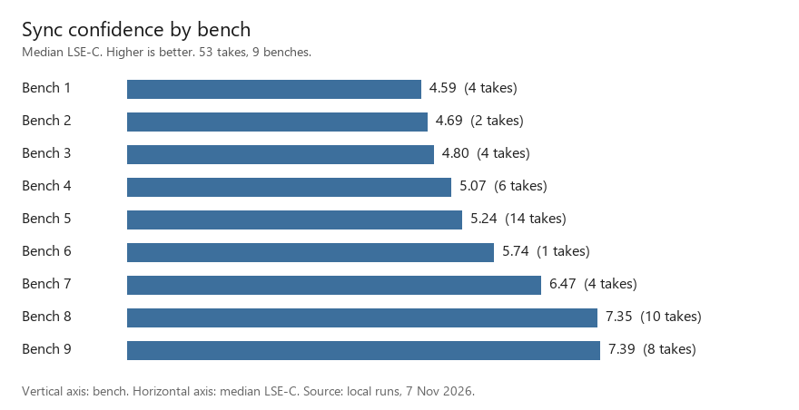
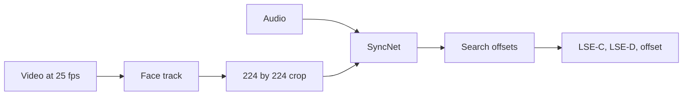

# SyncNet Lip-Sync Scorer

Scores how well a talking face matches its audio, on the CPU, so a batch of generated takes can be ranked before anyone watches them.



## Why it exists

Watching every take of a talking or singing face does not scale. This scores each file with the two numbers lip-sync papers use, then ranks the batch. It runs on the CPU so a GPU can keep rendering.

## How it works



- **LSE-C** is sync confidence. Higher is better.
- **LSE-D** is sync distance. Lower is better.
- **Offset** is how many frames the picture leads or lags the audio.
- The face tracker is MediaPipe Face Landmarker. The score itself is the SyncNet model from the VGG group's reference pipeline, the one Wav2Lip uses for these numbers.

Compare takes of the same audio. A gap under about 0.15 in LSE-C is within the noise of the method.

## Results

Checked against the unmodified reference pipeline on 11 sung takes:

| Check | Result |
|---|---|
| Ranking agreement | Spearman 0.97, the same order |
| LSE-C | Within 0.13 of the reference |
| Offset | One frame earlier than the reference, which delays MP4 picture by one frame |
| A vocal delayed 0.5 s | Offset moved from -3 frames to -15 |
| An unrelated vocal | LSE-C fell from 4.67 to 0.59 |
| Speed | About 20 s for a 16.7 s take on 8 threads. About 12 s per take in a batch |
| Memory | About 0.75 GB peak |

The chart is 53 later takes in 9 benches. Median LSE-C runs from 4.59 to 7.39. Bench names and pictures are not included.

## Quick start

```bash
pip install -r requirements.txt
python syncnet_score.py take1.mp4 take2.mp4 take3.mp4
```

Python 3.11, a CPU build of PyTorch, and ffmpeg on `PATH`. Both models download on first run. No API key.

<details>
<summary>Options and what the output means</summary>

One line per video, then a table ranked by LSE-C when there are several. Each video also gets a `<name>.syncnet.json` with `lse_c`, `lse_d`, `offset_frames`, `frames`, `face_rate` and `audio`. A failed video is reported and skipped. The exit code is non-zero if any failed.

| Option | Meaning |
|---|---|
| `--audio FILE` | Score every video against this audio |
| `--offset S` | Where the videos start inside that audio, in seconds |
| `--threads N` | CPU threads, default up to 8 |
| `--min-face-rate R` | Fail a video with a face in fewer than this share of frames. Default 0.5 |
| `--crops` | Also write the face crops, to check the tracking |
| `-v` | Timings, the mean face box and peak RAM |

The face box is median-smoothed, then resized to 224 by 224. Each 5-frame window is scored against 0.2 s of audio features. Offsets from -15 to +15 frames are searched. LSE-D is the minimum distance. LSE-C is the median distance minus that minimum.

`CUDA_VISIBLE_DEVICES` is cleared. ffmpeg pipes the frames, so there are no temp files.

The model definition follows [syncnet_python](https://github.com/joonson/syncnet_python) by Joon Son Chung (MIT). Paper: J. S. Chung and A. Zisserman, "Out of time: automated lip sync in the wild", ACCV 2016 workshops. The notice is in the source.

</details>

## How it was built

Built by directing AI coding agents in Cursor. I specified the reference method and the checks against it. The agents wrote the code. No license file: all rights reserved.
